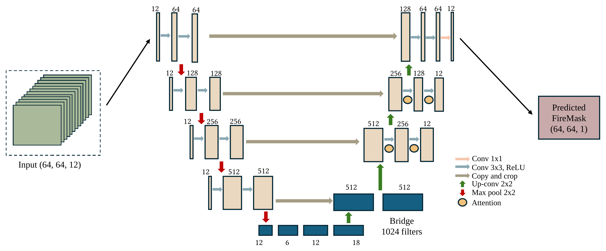
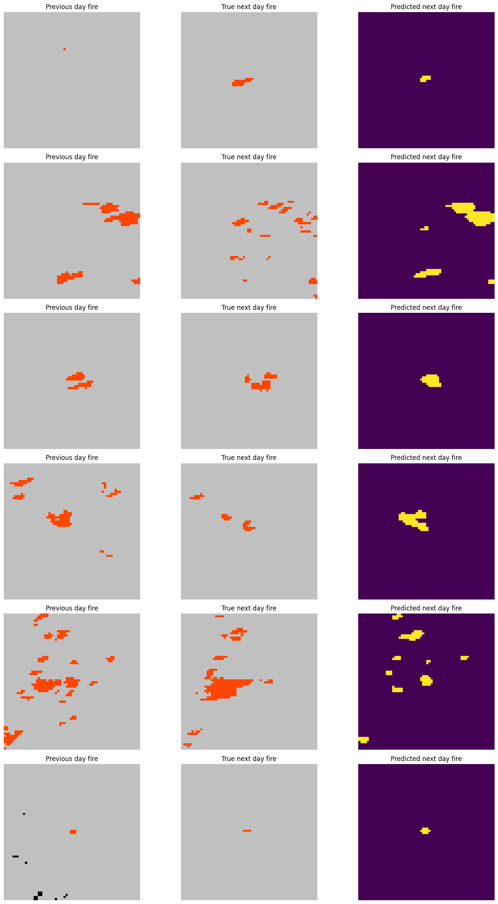
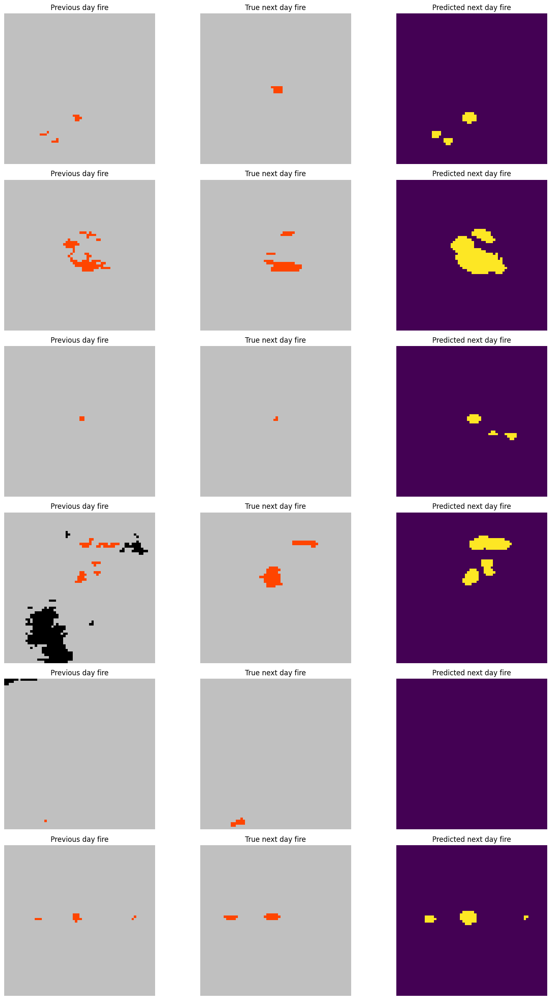

# Wildfire Spread Prediction

**Next-day wildfire spread prediction from remote-sensing, weather and terrain data, using an Attention U-Net.**

[](https://github.com/RashiChauhan67/wildfire-spread-prediction/actions/workflows/ci.yml)
[](LICENSE)


[Overview](#overview) · [Architecture](#architecture) · [Quick start](#quick-start) · [Dataset](#dataset) · [Results](#results) · [Notes](#notes)

## Overview

Given a 64 x 64 km patch for one day, the model predicts which pixels will be on fire the **next day**. The input stacks 12 channels: elevation (a digital elevation model), wind direction and velocity, minimum and maximum temperature, humidity, precipitation, drought index, vegetation, population density, energy release component, and the previous day's fire mask. Fire covers a small share of each patch, so the model is trained with a focal + Dice loss and scored with IoU.

This repository has a cleaned, tested Keras 3 implementation, the original experiment notebook, and the recorded results.

| | |
|---|---|
| Task | pixel-wise binary segmentation (next-day fire mask) |
| Input | 64 x 64 x 12 |
| Model | Attention U-Net, 32,455,045 parameters |
| Loss | focal + Dice |
| Metric | IoU (three conventions, see [Notes](#notes)) |
| Dataset | Next Day Wildfire Spread |

## Architecture



## Quick start

```bash
git clone https://github.com/RashiChauhan67/wildfire-spread-prediction.git
cd wildfire-spread-prediction
python -m venv .venv && source .venv/bin/activate
pip install -e .
```

Train and evaluate:

```bash
# Train (10 epochs, batch size 16, Adam 1e-4 by default), then evaluate on the test split
python scripts/train.py --data-dir data --output-dir runs/baseline

# Evaluate a saved model
python scripts/evaluate.py --data-dir data --model runs/baseline/model.keras
```

Training writes `model.keras`, `history.json` and `test_metrics.json` to the output directory. The seed is set with `--seed` (default 1337).

Use the model directly:

```python
from wildfire_unet import build_attention_unet

model = build_attention_unet()  # input (64, 64, 12), output (64, 64, 1)
```

## Dataset

[Next Day Wildfire Spread](data/README.md): 64 x 64 patches at 1 km resolution with train / eval / test splits, stored as TFRecord files. Data is not included; see [`data/README.md`](data/README.md) for the download, channel definitions and citation.

- Every channel except `PrevFireMask` is standardized per sample (z-score over that sample's own patch).
- In the raw labels, -1 marks unlabeled pixels. They are treated as "no fire", and every positive label becomes 1.

## Results

Recorded in the original notebook. **These were not re-run for this repository.**

Training log, 10 epochs (pixel IoU is the batch-level Keras metric):

| | Accuracy | IoU | Loss |
|---|---|---|---|
| Epoch 1, train | 0.9685 | 0.1765 | 0.8947 |
| Epoch 1, validation | 0.9785 | 0.1982 | 0.7608 |
| Epoch 10, train | 0.9914 | 0.4136 | 0.4456 |
| Epoch 10, validation | 0.9855 | 0.1642 | 0.7580 |

Training IoU rises over the 10 epochs while validation IoU stays between about 0.16 and 0.21, which points to overfitting. Accuracy is high from the first epoch because most pixels are not on fire, so IoU is the more informative metric. No single test result is reported here (see [Notes](#notes)).

Sample predictions. Left to right: previous-day fire, true next-day fire, predicted next-day fire.



A second set, which includes misses (for example a row where fire occurred but none was predicted):



## Notes

**Evaluation.** `scripts/evaluate.py` reports three IoU numbers, because the convention changes the value a lot:

| Metric | Definition |
|---|---|
| `mean_sample_iou` | IoU per 64 x 64 sample, averaged. A sample with no fire in both label and prediction scores 1.0. |
| `mean_sample_iou_fire_only` | The same, over samples whose label contains fire. |
| `pixel_iou` | Intersections and unions summed over the whole dataset. |

**Reproducibility.**
- The notebook printed two different test scores (0.3134 and 0.0768) from evaluation cells run at different points, with cells deleted in between, so they can't be attributed to one model. Neither is reported as the result.
- The saved notebook calls `dice_loss`, but its definition is missing from the file. `src/wildfire_unet/losses.py` uses a standard soft-Dice loss (smoothing 1.0); the original value is unknown, so training here is not guaranteed to match the notebook run.
- The rebuilt model has exactly 32,455,045 parameters, the count printed by the notebook's `model.summary()` (checked in `tests/test_model.py`).
- Tests run on synthetic data and need no dataset.

**Limitations.** Single-day input (no temporal model); per-sample z-scoring discards absolute magnitudes; fixed 0.5 threshold with no calibration; recorded validation IoU suggests overfitting.

## Repository structure

```
.
├── src/wildfire_unet/   # data pipeline, model, losses, metrics
├── scripts/             # train.py, evaluate.py
├── tests/               # unit tests (synthetic data)
├── notebooks/           # original experiment notebook
├── docs/figures/        # architecture figure
├── results/figures/     # prediction examples from the notebook run
└── data/README.md       # dataset instructions
```

Development: `pip install -e ".[dev]"`, then `ruff check .` and `pytest`.

## License

MIT. See [LICENSE](LICENSE). The dataset has its own license; check it before reuse.

## References

- F. Huot, R. L. Hu, N. Goyal, T. Sankar, M. Ihme, Y.-F. Chen. *Next Day Wildfire Spread: A Machine Learning Dataset to Predict Wildfire Spreading From Remote-Sensing Data.* IEEE Transactions on Geoscience and Remote Sensing, 2022.
- O. Oktay et al. *Attention U-Net: Learning Where to Look for the Pancreas.* MIDL 2018.
